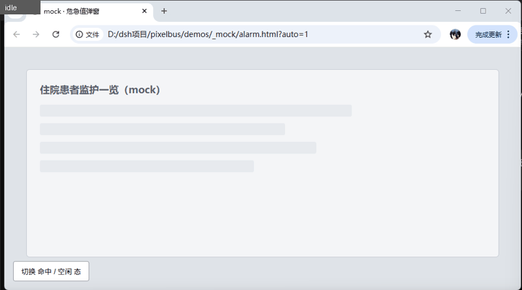
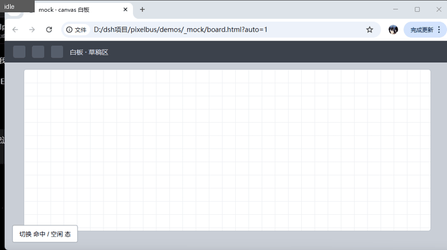
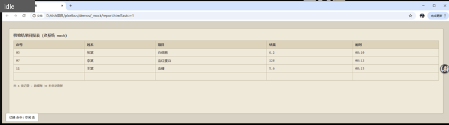

# demos：三个真实场景样例

每个 demo 是一份可直接 `pixelbus run` 的规则，外加一段 GIF，展示"屏幕状态变了 → 出事件 / 触发动作"。

仓库里这三段 GIF 是**用真机截出来的 hit/idle 两帧合成**的（idle → hit → idle 循环，命中帧左上角标 `HIT`），不是实时录屏：`python tools/make_demo_gif.py`。要录自己屏幕上的连续过程，用 `tools/record_gif.py`。

| Demo | 场景 | 判什么 | 实测（命中 / 空闲） | 规则 | GIF |
|---|---|---|---|---|---|
| 1 | HIS 里弹出的危急值红色提示条 | 红条颜色占比 | 0.835 / 0.000 | [alarm-popup/rules.yaml](alarm-popup/rules.yaml) |  |
| 2 | canvas 白板上出现一个箭头标记 | 单字形 + 瘦长宽高比 + 墨迹面积占比 | 三条全过 / 三条全失 | [canvas-board/rules.yaml](canvas-board/rules.yaml) |  |
| 3 | 老报表表格多出一行 | 和固定底图的灰度差 | 0.441 / 0.000 | [legacy-report/rules.yaml](legacy-report/rules.yaml) |  |

三个 demo 用的是不同的 `server.port` / `lock_port`（8787/8788、8789/8790、8791/8792），不会互相抢单实例锁。

## 怎么跑

```bash
# 1. 先看实时分数：窗口摆好、界面调到要演示的状态，再跑
pixelbus probe demos/alarm-popup/rules.yaml --region alarm

# 2. 跑起来：终端打事件，同时起 /events（SSE）给别的程序订阅
pixelbus run demos/alarm-popup/rules.yaml

# 3. 录 GIF（录之前把界面调好；--no-actions 避免录的时候真去 beep / 发 webhook）
python tools/record_gif.py demos/alarm-popup/rules.yaml --region alarm \
    --seconds 10 --out demos/alarm-popup/demo.gif --no-actions
```

## 素材说明

- `shots/` 里放你自己的截图（`hit.png` 命中态、`idle.png` 普通态），对照调阈值用；**截图含界面信息，不进 git**（目录里有 `.gitignore`）。每份 `shots/target.json` 记着全景图尺寸、窗口在图里的位置、目标框在图里/裁剪后的坐标——`tools/crop_demo_shots.py` 用它把全景图切出来。
- `demo.gif` 只裁窗口，不录全屏，随仓库一起发；用 `python tools/make_demo_gif.py` 从 `shots/` 重新合成。
- `baseline.png`（只有报表 demo 需要）是固定底图，跟着仓库走，因为它是"没有新行的干净表格"这张图本身，不含任何个人信息。
- 本仓库里的三条规则都是在这台 1920×1080、100% 缩放、Chrome 窗口固定位置的真机上标定的，**换机器必须重标**：

```bash
# 重新框区域并把坐标写回 YAML（会留一份 .bak）
pixelbus probe demos/alarm-popup/rules.yaml --pick alarm --apply

# 报表 demo 的固定底图也要重存（并且必须处在"没有新行"的空闲态）
pixelbus probe demos/legacy-report/rules.yaml --region table \
    --save-baseline demos/legacy-report/baseline.png
```

## 复现这三个界面（可选）

`_mock/` 里是三份本地 HTML，用来在没有真实 HIS / 白板 / 报表的机器上复现同样的画面，`?auto=1` 会每 9 秒自动循环一次"空闲 → 命中 → 空闲"，方便录 GIF：

```bash
# 三个窗口分屏摆好（Chrome 的 --window-position 对后开的窗口不生效，建议手动拖或写脚本 SetWindowPos）
chrome --new-window "file:///D:/dsh项目/pixelbus/demos/_mock/alarm.html?auto=1"
```

`_mock/` 目录整个不进 git（`demos/_mock/.gitignore` 里 `*`），它只是本地素材，不是产品的一部分。

## 一点提醒

- 像素阈值对**主题、字体、浏览器缩放、窗口位置**都敏感，抄数字没用，要用 `probe` 在自己机器上看数字。
- 区域里别留会自己动的东西（时钟、滚动字幕、桌面宠物浮层）。这类东西会让固定底图失效，判据时对时错 —— 见 `PITFALLS` 5.7。
- 报表演示只框了表格左侧两列，就是为了躲开会飘的桌面浮层；你换环境时优先考虑"把区域裁小、裁到静止的地方"。
